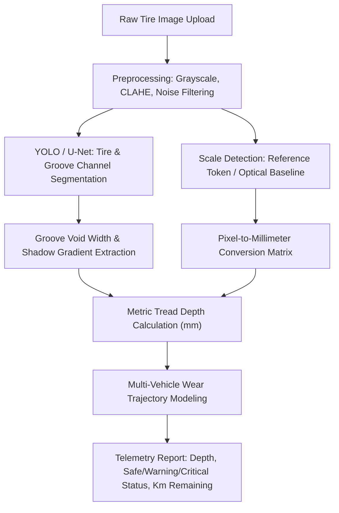

# AI-Based Tire Tread Depth Measurement – Implementation Plan and Guide
**Project: TYRZ LAB — Autonomous Optical Telemetry & Tread Wear Analytics**

---

## Executive Summary
This document outlines the end-to-end technical architecture and implementation roadmap for an AI-powered computer vision and telemetry system capable of measuring vehicle tire tread depth in millimeters with sub-millimeter precision. It details real-world constraints, optical calibration physics, classical and deep learning computer vision pipelines, multi-vehicle telemetry modeling, and production deployment considerations.

---

## 1. Project Goals and Success Metrics
- **Core Objective:** Provide real-time (<1.0s), camera-based optical scanning that calculates remaining tread depth ($mm$) per groove channel, predicts remaining service life ($km$), and enforces legal safety thresholds.
- **Accuracy Targets:**
  - Standard passenger/commercial tire legal minimum: $1.6\text{ mm}$ (2/32").
  - Motorcycle legal minimum: $1.0\text{ mm}$ (1/32").
  - Heavy commercial steer axle legal minimum: $3.2\text{ mm}$ (4/32").
  - Target error margin: Sub-millimeter accuracy ($\text{RMSE} \le 0.35\text{ mm}$, $\text{MAE} \le 0.25\text{ mm}$).
- **Inference Speed:** Real-time processing target of 15–30 FPS on edge/mobile devices, <500 ms on web/cloud API.
- **Robustness:** Resilient to varied tread patterns (directional, symmetrical, asymmetrical), surface dirt/dust, ambient lighting variations, and diverse tire aspect ratios.

---

## 2. Data Requirements & Pipeline
- **Image Specifications:** High-resolution RGB captures (minimum 1080p, recommended 2K–4K) with macro focus on tire contact patch and longitudinal grooves.
- **Annotation Strategy:**
  - *Segmentation Masks:* Delineation of longitudinal groove voids, lateral sipes, tread blocks, and wear indicator bars (Tread Wear Indicators - TWI).
  - *Metric Keypoints:* Calibration reference boundaries (coin diameter, scale card, or laser line baseline).
  - *Ground Truth Labels:* Calibrated digital depth gauge measurements (mm) recorded at outer, center, and inner ribs.
- **Synthetic Augmentation:** Lighting shifts ($\pm 25\%$), Gaussian noise, surface dust simulation, perspective shearing, and lens barrel distortion.

---

## 3. Optical Hardware & Capture Modalities
| Modality | Typical Hardware | Resolution / Baseline | Advantages | Limitations |
| :--- | :--- | :--- | :--- | :--- |
| **Monocular RGB + Scale** *(TYRZ Core)* | Smartphone / Web Camera / 8–12MP Industrial | 1080p – 4K @ 30 FPS | Ubiquitous, zero hardware cost, instant user adoption | Requires optical reference object or known camera distance |
| **Active Laser Profiler** | 650nm Line Laser + CMOS Sensor | 0.05 mm/px resolution | Sub-millimeter profiling of groove deformation | Requires aligned laser rig and eye-safety enclosure |
| **Stereo Vision** | Dual Synchronized Sensors (ZED 2i, OAK-D) | 12 cm baseline | Passive disparity depth without external markers | Higher computation, sensitive to textureless wet rubber |
| **ToF / LiDAR** | Intel RealSense L515 / iPhone LiDAR | 0.25m – 1.0m range | Direct point cloud acquisition | Low native resolution for fine groove crevices (<1.0mm) |

---

## 4. Calibration Physics & Pixel-to-Millimeter Conversion
In a pinhole camera model, the relationship between real-world dimension $L$ ($mm$) and image span $\Delta p$ ($pixels$) at focal distance $Z$ ($mm$) is governed by:

$$\text{Scale Factor } (S) = \frac{Z \cdot s_p}{f} = \frac{\text{Known Dimension } (mm)}{\text{Detected Dimension } (px)} \quad [mm/px]$$

Where:
- $f$ = Lens focal length ($mm$)
- $s_p$ = Sensor pixel pitch ($mm/pixel$)
- $Z$ = Working distance to tire tread ($mm$)

### Dynamic AI Reference Target Calibration
When an optical reference (e.g., standard coin or calibration card) is present in the frame:
$$\text{Groove Depth } (mm) = \Delta p_{\text{groove}} \times \left( \frac{\text{Reference Diameter}_{mm}}{\text{Reference Extent}_{px}} \right)$$

---

## 5. Machine Learning & Computer Vision Architecture

- **Groove Void Segmentation:** U-Net or YOLOv8-seg architecture identifies groove valleys versus elevated tread blocks.
- **Shadow Gradient & Edge Analysis:** Canny edge detection and directional Sobel gradients identify groove floor depth transitions.
- **Wear Degradation Model:**
  $$\text{Remaining Life } (km) = \min\left(\text{AvgLifespan}_{km}, \frac{\max(0, \text{Depth}_{mm} - \text{LegalMin}_{mm})}{\text{WearRate}_{mm/1000km}} \times 1000\right)$$

---

## 6. Multi-Vehicle Dynamic Telemetry Dataset (TYRZ Lab Standard)
The system adapts baseline depth, legal cutoffs, and wear degradation rates dynamically across 9 vehicle categories:

| Category | Baseline ($mm$) | Legal Cutoff ($mm$) | Warning Threshold ($mm$) | Wear Rate ($mm/1k\text{ km}$) | Calibrated Lifespan ($km$) |
| :--- | :---: | :---: | :---: | :---: | :---: |
| 🚗 **Passenger Car** | 8.0 | 1.6 | 3.0 | 0.142 | 45,000 |
| 🚙 **SUV / Crossover** | 10.0 | 1.6 | 3.5 | 0.168 | 50,000 |
| 🛻 **Pickup / Light Truck** | 11.0 | 1.6 | 4.0 | 0.171 | 55,000 |
| 🚚 **Commercial Semi-Truck** | 18.0 | 3.2 | 5.5 | 0.148 | 100,000 |
| 🚌 **Transit Bus / Coach** | 16.0 | 3.2 | 5.0 | 0.160 | 80,000 |
| 🚐 **Commercial Van / LCV** | 9.5 | 1.6 | 3.2 | 0.175 | 45,000 |
| 🏍️ **Motorcycle / Superbike** | 7.0 | 1.0 | 2.0 | 0.400 | 15,000 |
| ⚡ **Electric Vehicle (EV)** | 8.0 | 1.6 | 3.2 | 0.183 | 35,000 |
| 🏎️ **Supercar / Track GT** | 7.5 | 1.6 | 3.0 | 0.295 | 20,000 |

---

## 7. Testing, Quality Assurance & Error Mitigation
- **Validation Dataset:** Benchmark collection of 100+ annotated tire captures spanning brand-new, half-life, warning zone, and illegal/bald treads across passenger cars, commercial vehicles, and two-wheelers.
- **Key Failure Modes & Solutions:**
  - *Specularity & Glare:* Mitigated via Contrast Limited Adaptive Histogram Equalization (CLAHE).
  - *Dirty / Muddy Grooves:* High-frequency spatial filter detects channel occlusion and alerts the operator to clean the groove before scan.
  - *Scale Skew:* Bounding box circularity verification ensures the reference coin/marker is viewed at an orthogonal angle ($\pm 15^\circ$).

---

## 8. Deployment Stack
- **Frontend:** Pure HTML5 Canvas overlay, responsive telemetry dash, real-time client-side fallback computation.
- **Backend API:** Node.js HTTP microservice with MongoDB database integration for multi-tenant telemetry history.
- **Edge / Cloud Hosting:** Deployed on Render with zero-latency image processing.
